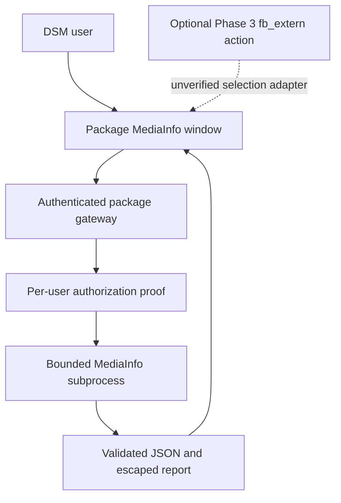

# MediaInfo integration feasibility

Research date: 2026-10-23. Target: DSM 7.4. Status: investigation only. The approved delivery scope is in the [three-phase roadmap](phases/README.md).

**Follow-up finding:** inspecting existing packages revealed an undocumented `fb_extern` registration in official legacy Text Editor and PDF Viewer SPKs. See [the package investigation](package-integration-research.md) for primary artifact evidence and limitations. This supplies a concrete package-only candidate for testing; obtaining Synology confirmation is optional and is no longer a prerequisite for further investigation.

## Decision

A small open-source package can invoke SynoCommunity’s MediaInfo binary and display metadata in its own DSM application window. **The requested File Station entry point is not established as feasible through public, supported extensions.** Neither the Package Developer Guide nor the File Station API guide documents registration of third-party context menu actions or Properties tabs. This is a finding about the published interfaces, not proof that private hooks cannot exist. [1][2]

Do not promise supported DSM 7.4 integration until a supported extension contract is established. The discovered `fb_extern` mechanism can be investigated independently as an undocumented compatibility route. The roadmap makes it an optional, experimental Phase 3 feature; it does not delay a standalone package.

## Evidence and confidence

| Requirement | Finding | Status |
| --- | --- | --- |
| Install an open-source SPK | Package format and integration mechanisms are documented | Supported mechanism; target build untested |
| Launch a package from the DSM desktop | `dsmuidir`, `dsmappname`, and application config are documented | Supported [3][4] |
| Show a native DSM application window | Documented `type: app`, `v-app-instance`, and `v-app-window` examples exist | Supported API surface; 7.4 behavior untested [5][6] |
| Add “View MediaInfo” to File Station | No public registration mechanism found; legacy `fb_extern` evidence exists | Undocumented Phase 3 gate [1][2] |
| Add a MediaInfo tab to File Station Properties | No public tab provider mechanism found | Out of scope [1][2] |
| Obtain File Station’s current selection | No documented callback; legacy callbacks receive records | Undocumented Phase 3 gate [2] |
| Run MediaInfo locally | Published SynoCommunity package contains CLI and libraries | Archive verified; runtime untested [10][11] |

“Supported” here means described by Synology’s public documentation. It does not mean Synology has certified this proposed package, approved distribution, or verified these older examples against DSM 7.4.

The live guide identifies itself as **DSM 7.2.2**. The File Station PDF carries a 2023 copyright and ends with revision history through 2023. Neither establishes a DSM 7.4 extension contract. Synology publishes a DSM 7.4 File Station specifications page, but that is a product description rather than an extension SDK. [1][2][14]

Context7 was consulted first. It did not resolve the package developer guide itself; its Synology knowledge-base entry returned no matching extension documentation. The investigation therefore used Synology’s original HTML guide and downloaded PDFs. MediaInfo documentation was also queried through Context7 and checked against upstream sources. No NAS was accessed.

## What the official interfaces actually provide

### Package and window integration

`dsmuidir` registers package-owned UI files; `dsmappname` identifies the application opened from Package Center. DSM manages the corresponding UI link. These declarations register the package’s application, not an extension inside File Station. [3][4]

There are two documented UI approaches:

- The Application Config chapter describes `.url` entries with `type: url`, opening a URL in a popup. This alone is not evidence of a native DSM application window or a File Station action. [7]
- The UI files chapter and UI Framework appendix document a package application with `type: app`, a Vue entry point, and `v-app-instance` / `v-app-window`. This is the relevant starting point for a genuine DSM window. Its example uses Vue 2.7.14; verify the target runtime and available build tooling before choosing dependencies. [5][6]

A read-only MediaInfo window could use General, Video, Audio, Text, and Chapters sections plus a selectable raw report. Match DSM spacing and controls, keep long values copyable, and use Close rather than the Properties dialog’s Save button. This is a proposed UI, not an implemented mockup.

### File Station API

The documented API is HTTP/HTTPS file access, not a frontend plugin SDK. Relevant operations are:

| Interface | Use |
| --- | --- |
| `SYNO.API.Info` | Discover endpoint paths and supported versions |
| `SYNO.API.Auth` | Establish/end a user session |
| `SYNO.FileStation.List` | `list_share`, `list`, and `getinfo` for browsing and metadata |
| `getinfo` additional fields | `real_path`, `perm`, `size`, `time`, and mount information |
| `perm.acl.read` | Report the logged-in user’s read privilege |
| `SYNO.FileStation.Download.download` | Retrieve a single file’s bytes |

Use share-relative API paths such as `/video/Movies/The Matrix (1999).mkv`; physical paths are separate. The documented `CheckPermission` method is **write**, not a general-purpose read authorization method. No menu-registration, Properties-tab, current-selection, or arbitrary command-execution endpoint is documented. See PDF introduction, pp. 5–7, 31–36, 65–66, and 71–72. [2]

API discovery does not turn an otherwise undocumented endpoint into a supported extension contract.

## Can context menus work without changing DSM files?

**Through a documented SPK extension: not established.** No manifest field, resource worker, callback signature, or supported example was found. The same applies to adding a Properties tab. The public guide covers desktop applications and resource integration, but supplies no File Station UI extension chapter. [1][3]

Separate the possible workarounds:

| Approach | Changes DSM/File Station files? | Assessment |
| --- | --- | --- |
| Package’s own DSM app and file browser | Only package files and DSM-managed registrations | Feasible fallback; no File Station menu |
| Package-owned `fb_extern` registration | No File Station patch apparent in inspected legacy Text Editor package | Concrete undocumented mechanism found in follow-up; third-party DSM 7.4 acceptance unverified |
| Runtime patching of File Station JavaScript | Potentially no disk edits, if code can be loaded | Undocumented; no verified loading hook or implementation found |
| Editing/replacing File Station bundles or DSM bootstrap files | Yes | Outside the proposed supported architecture; update and uninstall hazards |

“No system-file modifications” does not make JavaScript injection officially supported. It depends on private DOM/component details and is excluded from this project. A Properties tab would require similarly unverified knowledge of the dialog lifecycle.

Do not assume that first-party integrations imply a public plugin API. Do not treat `.url`, `preloadTexts`, or permission configuration as a script-injection mechanism. Browser injection is excluded from the approved roadmap. [7][8]

## SynoCommunity dependency: verified details

On the research date, the public package page listed **MediaInfo 26.05-16**, published 2026-08-02, with DSM 7.x builds labelled 7.1 for multiple architectures. The source recipe declares package ID `mediainfo`, `SPK_COMMANDS = bin/mediainfo`, and a non-startable CLI package. [10][11]

I downloaded the linked x64-family SPK and inspected its tar members without installing or executing them:

| Archive observation | Value |
| --- | --- |
| `INFO.package` | `mediainfo` |
| `INFO.version` | `26.05-16` |
| `INFO.os_min_ver` | `7.1-42661` |
| Payload | `bin/mediainfo`, `lib/libmediainfo.so*`, `lib/libzen.so*` |
| Privilege default | `run-as: package` |
| Internal username / group | `sc-mediainfo` / `synocommunity` |
| Archive bytes | 4,587,520 |
| Archive SHA-256 | `0e13e5aecfba3bbd91713f1900dd0e14b7c25b7813a2d70936e01ab7bc7f3235` |

The digest records the inspected artifact; it is not an independent authenticity attestation. The archive is linked from [10], x64 download, filename beginning `mediainfo.v16.f42661`.

Combining the payload with Synology’s package target convention gives the expected executable **`/var/packages/mediainfo/target/bin/mediainfo`**. Verify executable permissions and library resolution under the new package’s account on the target NAS. Prefer this stable package path over PATH lookup or a hard-coded `/volume1/@appstore` path. [4][11]

Declare `mediainfo` through the documented package dependency mechanism, selecting a minimum tested version after runtime validation. A 7.1 minimum version and listed CPU architecture do not prove DSM 7.4 compatibility. [4]

Upstream currently advertises 26.10, ahead of SynoCommunity’s listed build. Review the intervening parser fixes when deciding whether 26.05 is acceptable for untrusted media. Do not claim the dependency is current solely because Package Center offers it. [12][13]

## Minimal architecture proposal

The following design is a proposal. Authentication, routing, and file access remain validation gates.

### Initial secure-analysis investigation

Use one SPK with a package-owned UI, a small gateway/worker, and an external dependency on `mediainfo`. Start with one local regular media file per request and no persistent analysis database.

1. **Authenticate every request.** Synology documents invoking `authenticate.cgi` from a custom CGI with the request environment; it returns the authenticated username. This authenticates identity, not file access. Verify this on 7.4, including expiry and proxy access. Do not accept a username supplied by the browser. [9]
2. **Protect the gateway.** Require authenticated POST requests, an app CSRF token, origin checks, bounded input, and explicit application access policy. Menu visibility is not authorization. Forward only required validated request context; never trust public headers as identity.
3. **Prove access to the original file.** Bind the authenticated user, effective DSM ACL decision, and exact opened file. Keep credentials and session material out of URLs, logs, persistent storage, and subprocess arguments. If this cannot be demonstrated safely, halt product implementation rather than letting a privileged package account read files on the user's behalf.
4. **Use temporary copying only diagnostically.** A package-private, seekable temporary copy may help diagnose request routing and parser behavior. It must be random-named, inaccessible through the web server, quota-bound, cancellable, and cleaned after every lifecycle path. It is not the production design for large media.
5. **Run a fixed executable with fixed options.** Invoke the absolute binary through an argument array with `--Output=JSON` and one verified authorized filename. Use a minimal child environment without request cookies, session tokens, or other gateway secrets. No shell, user options, URLs, templates, or directory input. Upstream supports JSON output. [15]
6. **Bound and contain parsing.** Use a package account with no elevation and restricted writable storage. Limit wall time, CPU, memory, concurrent jobs, stdout, and stderr; terminate the process group on cancellation. Establish per-job filesystem isolation and network restrictions before release, including separation from other users’ temporary inputs. Available DSM containment facilities remain unverified. Media formats can reference other files, so rejecting URL input alone is insufficient isolation.
7. **Return data safely.** Validate JSON shape and size, render strings as text, and replace local paths in the report with the authorized display name. Scope results to the requesting session; use `Cache-Control: no-store`. Start without shared caching. Treat tags as untrusted content.

`conf/privilege` documents a package runtime identity. The documented Web Config resource can register package-owned routing. The Web Service worker depends on Web Station and is excluded because the package may not require another installed runtime dependency. Neither automatically provides authentication or an authorization policy. Phase 1 must assess DSM's built-in PHP route first, then use a bundled Go fallback if required. Do not hand-edit global nginx files. [8][16][17]

**Cost of diagnostic copying:** the 17.33 GiB / 18,605,821,335-byte example needs approximately that much additional free space per active analysis, plus overhead. It avoids downloading the movie to the browser, but still adds substantial NAS I/O and latency. Measure it as a diagnostic; it does not satisfy the Phase 2 authorization and performance gate.

### Fast local access: a separate unresolved gate

The preferred product behavior is to analyze the original file in place. Do not replace the baseline with “a daemon can read the share, therefore any logged-in user can analyze it.” That creates a metadata disclosure path.

A fast variant must securely bind the authenticated identity, effective DSM/Windows ACL permissions, and the exact opened file. A server-side `getinfo` permission check is useful, but checking a pathname and subsequently reopening it under a more privileged service account introduces replacement/symlink races. POSIX mode bits alone do not reproduce DSM ACL decisions.

Before choosing this variant, establish either a documented per-user file-open facility, or a narrowly scoped broker that opens the file with the caller’s effective permissions and transfers only an authorized descriptor. The latter needs a separate security review and evidence that DSM ACL behavior is preserved; adding a root or setuid helper is not a routine implementation detail. Descriptor input to the packaged CLI must also be tested.

For either variant, initially exclude remote/cloud mounts, directories, devices, FIFOs, playlist/reference inputs, and symlinks escaping allowed storage. Validate canonical paths and stable file identity in the direct variant. Handle rename, deletion, access revocation, and changing files explicitly.

## Blockers and next investigation gates

| Gate | Evidence needed before implementation/release |
| --- | --- |
| **File Station compatibility** | A disposable DSM 7.4 test proves or rejects third-party `fb_extern` registration, selection payload, lifecycle, and reversible removal; official confirmation would upgrade confidence but is not required for investigation |
| **Target environment** | NAS model, CPU architecture, exact DSM build, File Station version, and a disposable test environment |
| **UI/tooling** | Ability to build and open the documented application window on 7.4 without editing File Station; confirm redistribution terms for any SDK/build assets |
| **Authentication/routing** | Working package gateway, session verification, CSRF protection, logout/expiry behavior, and HTTPS/reverse proxy behavior |
| **User file access** | Reliable user-session download, or a verified direct-open design preserving effective permissions |
| **MediaInfo runtime** | Dependency install, executable/library compatibility under the new package account, representative JSON output, parser containment, and update policy |
| **Usability/performance** | Latency and temporary-space measurements for large MKV/MP4 files; cancellation and resource ceilings |
| **Packaging lifecycle** | Clean install, upgrade, restart, dependency absence/update/removal handling, and uninstall without DSM edits or retained media copies |

Useful negative cases for a later prototype are two users with different ACLs, explicit deny entries, expired sessions, tampered paths, symlink replacement, malicious tags, malformed media, disk exhaustion, and concurrent requests. These are proposed acceptance checks; none have been run.

The next step is [Phase 1](phases/01-proof-of-concept.md): investigate the package-owned `fb_extern` registration identified in [existing packages](package-integration-research.md), its handling by File Station on DSM 7.4, and safe per-user media access. Synology confirmation could establish official support, but is not required to examine this route. The standalone viewer remains the product path if the registration is unavailable.

## References

1. [Synology Package Developer Guide](https://help.synology.com/developer-guide/) and [downloadable DSM 7 guide](https://global.download.synology.com/download/Document/Software/DeveloperGuide/Os/DSM/All/enu/DSM_Developer_Guide_7_enu.pdf). Reviewed contents, UI files, integration, privilege, and resource chapters; searched the PDF for File Station, context menus, and extensions.
2. [Synology File Station Official API guide](https://global.download.synology.com/download/Document/Software/DeveloperGuide/Package/FileStation/All/enu/Synology_File_Station_API_Guide.pdf). Page references use the printed page numbers, matching the PDF page indices in this edition.
3. [Desktop Application integration](https://help.synology.com/developer-guide/integrate_dsm/desktopapp.html).
4. [INFO optional fields](https://help.synology.com/developer-guide/synology_package/INFO_optional_fields.html): `dsmuidir`, package dependencies; package target convention is described in the downloaded guide’s package.tgz chapter, printed p. 53.
5. [UI files — Launch an App](https://help.synology.com/developer-guide/synology_package/package_tgz/launch_app.html).
6. [UI Framework — Application](https://help.synology.com/developer-guide/appendix/ui_framework/application.html).
7. [Application Config](https://help.synology.com/developer-guide/integrate_dsm/config.html).
8. [Privilege Config](https://help.synology.com/developer-guide/privilege/privilege_config.html).
9. [Application Authentication](https://help.synology.com/developer-guide/integrate_dsm/web_authentication.html).
10. [SynoCommunity MediaInfo package and architecture downloads](https://synocommunity.com/package/mediainfo).
11. [SynoCommunity MediaInfo recipe, pinned to last recipe change](https://github.com/SynoCommunity/spksrc/blob/a3ef1d4c8d835da8a12fd1c1e93f65b7f4a690f3/spk/mediainfo/Makefile). Commit timestamp: 2026-08-02. Recipe and archive were read directly; no binary was run.
12. [MediaInfo upstream overview and license](https://mediaarea.net/en/MediaInfo).
13. [MediaInfo upstream changelog](https://mediaarea.net/MediaInfo/ChangeLog).
14. [DSM 7.4 File Station technical specifications](https://www.synology.com/en-global/dsm/7.4/software_spec/file_access).
15. [Upstream CLI JSON behavior discussion](https://github.com/MediaArea/MediaInfo/issues/1103) and [MediaInfoLib JSON serialization source](https://github.com/MediaArea/MediaInfoLib/blob/master/Source/MediaInfo/MediaInfo_Inform.cpp). Use one file per process to avoid multi-file output-shape differences.
16. [Web Config resource](https://help.synology.com/developer-guide/resource_acquisition/web_config.html).
17. [Web Service resource](https://help.synology.com/developer-guide/resource_acquisition/web_service.html).
